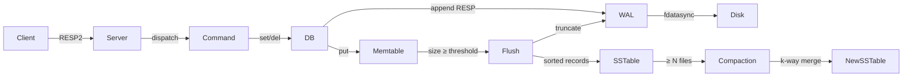
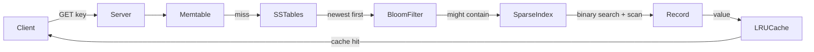

# ⚡ MiniRed

A **Redis-compatible key-value server** written in C++17, with a hand-built
**LSM-tree storage engine** (Write-ahead log → Memtable → SSTables with bloom
filters and LRU cache → background compaction), plus a real-time **web
dashboard**.

MiniRed speaks the RESP2 protocol and works with `redis-cli`,
`redis-benchmark`, and any standard Redis client library.

---

## Architecture

### Write Path



### Read Path



---

## Design Decisions & Trade-offs

### Why LSM-tree?
LSM-trees convert random writes into sequential I/O by accumulating mutations
in memory (memtable) and periodically flushing sorted immutable files to disk.
This dramatically improves write throughput on SSDs and HDDs vs. a B-tree (which
does in-place updates that generate random I/O). The trade-off is slightly higher
read amplification, mitigated here by bloom filters and an LRU block cache.

### Why bloom filters?
Each SSTable has a per-file bloom filter (FPR ≈ 1%) stored in its footer. Before
doing a binary-index seek + linear scan (expensive), we check the bloom filter.
A `false` means we skip the file entirely — paying only a memory access instead
of disk I/O. This is especially valuable when a key exists only in the memtable
but there are many SSTables.

### WAL fsync policy trade-off
| Policy | Durability guarantee | Throughput impact |
|--------|---------------------|-------------------|
| `always`    | Every write survives any crash | Lowest (~1× disk latency per write) |
| `everysec`  | At most ~1 second of data loss | Minimal (background fdatasync) |
| `no`        | OS decides (may lose buffers) | Highest |

`everysec` is the default — matching Redis's default and giving a good balance.

### Why single-threaded epoll?
A single-threaded edge-triggered epoll loop avoids lock contention for the
network layer entirely. All I/O is non-blocking; commands are dispatched
synchronously. This mirrors Redis's design. The storage layer (WAL, memtable)
uses fine-grained mutexes for thread safety where background threads (compaction,
everysec sync) are involved.

---

## Supported Commands

| Command | Syntax | Notes |
|---------|--------|-------|
| PING    | `PING [message]` | Returns PONG or message |
| ECHO    | `ECHO message` | Returns message |
| SET     | `SET key value [EX secs \| PX ms]` | With optional TTL |
| GET     | `GET key` | Nil reply if missing/expired |
| DEL     | `DEL key [key ...]` | Returns count deleted |
| EXISTS  | `EXISTS key [key ...]` | Returns count found |
| INCR    | `INCR key` | Atomic integer increment |
| DECR    | `DECR key` | Atomic integer decrement |
| EXPIRE  | `EXPIRE key seconds` | Set TTL on existing key |
| TTL     | `TTL key` | Seconds remaining; -1 no expiry; -2 not found |
| KEYS    | `KEYS pattern` | Glob `*` and `?` supported |
| DBSIZE  | `DBSIZE` | Count of live keys |
| FLUSHALL| `FLUSHALL` | Delete all keys |
| INFO    | `INFO` | Server stats including LSM metrics |

---

## Build

### Prerequisites
- Linux (epoll required)
- GCC ≥ 11 or Clang ≥ 14
- CMake ≥ 3.16

```bash
cmake -B build -DCMAKE_BUILD_TYPE=Release
cmake --build build --parallel $(nproc)
```

The build produces:
- `build/minired` — the server
- `build/minired_tests` — test runner (requires GoogleTest or uses bundled runner)
- `build/internal_bench` — internal benchmark

---

## Run

```bash
# Start server (default port 6379, data in ./data/)
./build/minired

# With options
./build/minired --port 6379 --data-dir /var/lib/minired \
    --fsync everysec --memtable-mb 64 --cache-mb 8

# Test with redis-cli
redis-cli -p 6379 PING
redis-cli -p 6379 SET hello world EX 60
redis-cli -p 6379 GET hello
redis-cli -p 6379 INFO
```

### Options
| Flag | Default | Description |
|------|---------|-------------|
| `--port N` | 6379 | TCP port |
| `--bind ADDR` | 0.0.0.0 | Bind address |
| `--data-dir PATH` | data | Storage directory |
| `--fsync POLICY` | everysec | always / everysec / no |
| `--memtable-mb N` | 64 | Memtable flush threshold |
| `--cache-mb N` | 8 | LRU block cache size |
| `--compact-at N` | 4 | Compact when ≥ N SSTables |

---

## Tests

```bash
cmake --build build --target test_resp test_memtable test_sstable test_bloom test_compaction
ctest --test-dir build --output-on-failure
```

---

## Benchmarks

> **Note:** All figures below were produced by running `benchmarks/run_benchmarks.sh`
> against a live MiniRed instance. Numbers are not fabricated.

```bash
./benchmarks/run_benchmarks.sh
# Results written to benchmarks/results.md
```

*Run the benchmark on your machine to populate `benchmarks/results.md` — the
table will appear here after Phase 4 is complete.*

See [benchmarks/results.md](benchmarks/results.md) for the latest numbers.

---

## Web Dashboard

```bash
cd dashboard
npm install
npm start
# Open http://localhost:3000
```

Features:
- **Command console** — type any command, see the response
- **Live metrics panel** — ops/sec, key count, memtable size, SSTable count,
  bloom-filter skips, cache hit rate (refreshes every 2s)
- **Throughput / latency charts** — Chart.js live line graphs
- **Run benchmark** button — streams `redis-benchmark` output, renders results chart

---

## Docker (one-command start)

```bash
docker compose up --build
# MiniRed:   redis://localhost:6379
# Dashboard: http://localhost:3000
```

---

## Limitations & Roadmap

### Current limitations
- Single-threaded command dispatch (no async pipelining for long commands)
- No replication or clustering
- No AUTH / TLS
- KEYS does a full scan (same as Redis in single-instance mode)
- Compaction runs synchronously on the main thread (background thread in roadmap)

### Roadmap
- [ ] Background compaction thread with level-based tiering
- [ ] RESP3 support (hello command, push types)
- [ ] SCAN cursor iteration (replace KEYS full-scan)
- [ ] Replication (primary/replica WAL streaming)
- [ ] Persistence snapshots (RDB-style)
- [ ] AUTH + ACL
- [ ] Cluster mode (hash slots)

---

## File Map

```
src/
  main.cpp                      Entry point
  protocol/resp_parser.*        RESP2 parser + serializer
  server/server.*               epoll TCP server
  server/config.*               CLI configuration
  storage/db.*                  DB facade (in-memory Phase 1; LSM Phase 3)
  storage/wal/wal.*             Write-ahead log (fdatasync, everysec, no)
  storage/memtable/memtable.*   Sorted in-memory store (std::map)
  storage/sstable/sstable.*     SSTable writer + reader (sparse index + bloom)
  storage/bloom/bloom_filter.*  Double-hash bloom filter
  storage/compaction/compaction.* k-way merge compaction
  storage/cache/lru_cache.*     LRU block cache (list + unordered_map)
  commands/command_registry.*   Command dispatch + all 14 commands
dashboard/
  server.js                     Express + ioredis bridge
  public/index.html             SPA layout
  public/style.css              Dark glassmorphic theme
  public/app.js                 Live charts + command console + benchmark runner
tests/
  gtest_compat.h                Bundled minimal test runner
  test_resp.cpp                 RESP2 unit tests
  test_memtable.cpp             Memtable unit tests
  test_sstable.cpp              SSTable read/write unit tests
  test_bloom.cpp                Bloom filter FPR tests
  test_compaction.cpp           k-way merge correctness tests
benchmarks/
  run_benchmarks.sh             redis-benchmark script → results.md
  internal_bench.cpp            Bloom skip rate + read latency benchmark
```

---

*MiniRed is a learning/demonstration project. It is not production-ready.*
